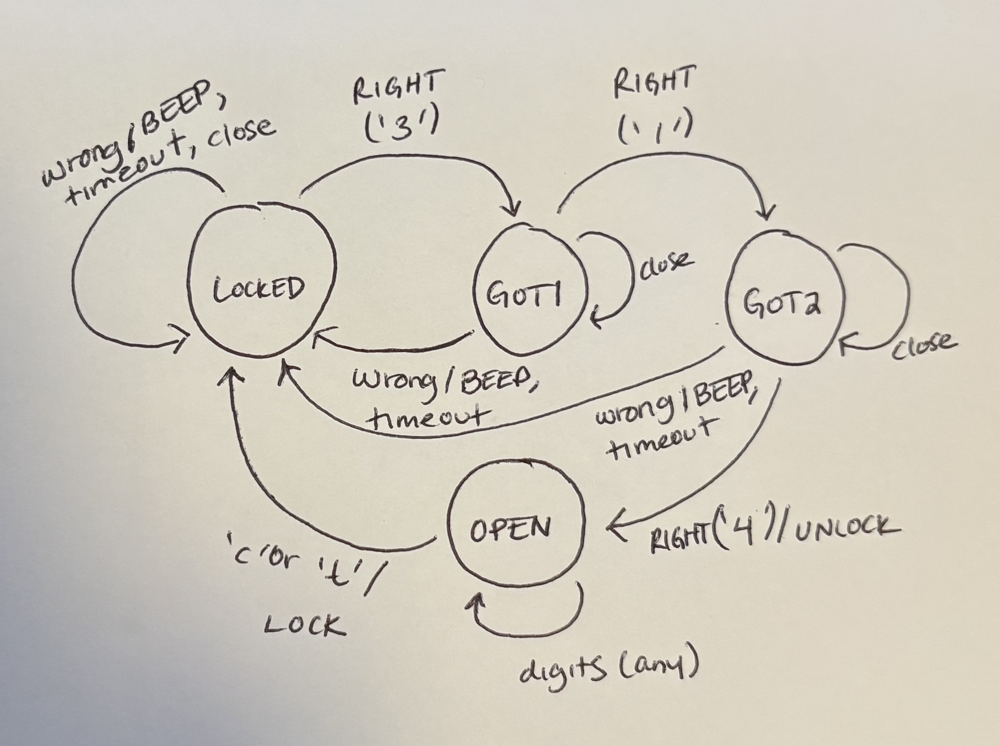

# ECE 361, HW 5: Combination lock

A finite state machine written as a table. The code is **3-1-4**. One table lookup (`lock_step`) replaces a chain of ifs.

## Build and test

```bash
make                       # builds ./lock (gcc -std=c11 -Wall -Wextra, no warnings)
./lock < data/codes.txt    # one trace line per event, then "final: STATE"
make test                  # builds and runs tests/test_lock.c; exit status is nonzero on any failure
make clean                 # removes lock, test_lock, and every .o
```

Example trace line: `GOT2 4 RIGHT -> OPEN UNLOCK` (state, character, event, next state, action).

## Input characters

| Character | Event |
|---|---|
| the next digit of the code for the current state | `E_RIGHT` |
| any other digit | `E_WRONG` |
| `c` (door closes) | `E_CLOSE` |
| `t` (5-second timer runs out) | `E_TIMEOUT` |
| anything else (newline, space, letters) | `-1`, skipped |

## State diagram




## Transition table

Rows are states, columns are events. Each cell is `next state / action`. All 16 cells are written in `lock.c` with designated initializers.

| State \ Event | E_RIGHT | E_WRONG | E_CLOSE | E_TIMEOUT |
|---|---|---|---|---|
| **LOCKED** (initial) | GOT1 / A_NONE | LOCKED / A_BEEP | LOCKED / A_NONE | LOCKED / A_NONE |
| **GOT1** | GOT2 / A_NONE | LOCKED / A_BEEP | GOT1 / A_NONE | LOCKED / A_NONE |
| **GOT2** | OPEN / A_UNLOCK | LOCKED / A_BEEP | GOT2 / A_NONE | LOCKED / A_NONE |
| **OPEN** | OPEN / A_NONE | OPEN / A_NONE | LOCKED / A_LOCK | LOCKED / A_LOCK |

## Design decisions

- **Timeout while LOCKED:** the description only has the timer running while a code is typed or while the door is open, so `t` in LOCKED should not happen. If it does, the lock stays LOCKED and does nothing.
- **Digits while OPEN:** there is no next digit while the door is open, so `lock_event` returns `E_WRONG`. The table maps both `E_RIGHT` and `E_WRONG` in OPEN to `OPEN / A_NONE`, so digits do nothing either way.
- **A wrong digit starts over completely:** in `3 3 1 4`, the second `3` is wrong in GOT1, so the lock goes back to LOCKED. It does not count as a new first digit, so `1` and `4` are then wrong too and the lock does not open.
- **Input is one stream:** `main.c` does not reset the lock at a newline, so the state carries over from one line of `data/codes.txt` to the next.

## Tests (`tests/test_lock.c`)

- every one of the 16 table entries, through `lock_step`
- `lock_event` for a right and a wrong digit in each state, digits while open, and `c`, `t`, and other characters
- the sequences `3 1 4` (opens), `3 3 1 4` (does not), `3 1 t 4` (does not), and `3 1 4 c` (locks again)
